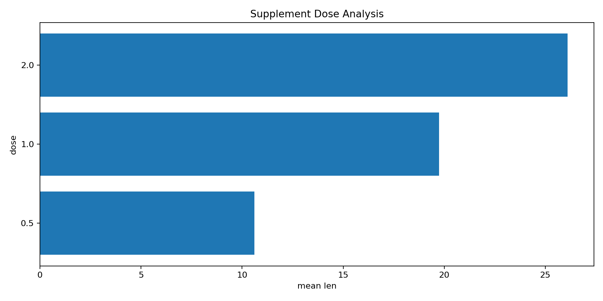

# Supplement Dose Analysis — executed results

## Decision question
How does tooth length differ by supplement dose?

## Evidence
The largest observed mean len is 26.100 for 2.0. This ranking is descriptive, not a recommendation.

Raw rows: 60. Rows used: 60. Excluded for missing/nonfinite required values or invalid denominator: 0.

## Method
Complete-case descriptive comparison of len by dose; show group counts, mean, minimum and maximum.

## Interpretation and limitations
Guinea-pig experiment; findings are not human medical advice. No causal inference, significance claim or production deployment is implied. Missing values are not imputed; identical rows are retained. Small or repeated samples limit uncertainty interpretation.

## Recommended next decision
Inspect supplement-specific dose patterns and experimental design.

## Reproducibility
Source and exact downloaded-byte SHA256 are recorded in run_manifest.json. SQL results are in answer.csv and analysis.sqlite. Review quality_audit.csv before interpretation.
